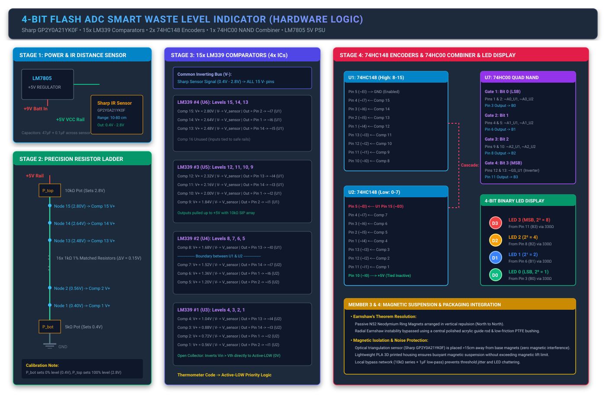

# 🗑️ Smart Waste Level Indicator using Pure Hardware Logic

[](#)
[-red.svg)](#)
[](#)
[](./simulations/)
[](./LICENSE)

A discrete analog and digital hardware design for a **smart waste level indicator bin** built using **ONLY hardware logic gates and analog comparators**—completely eliminating microcontrollers, Arduino, firmware, or software code.

The system translates an analog infrared triangulation distance sensor (**Sharp GP2Y0A21YK0F**) into an instantaneous **4-bit binary output (`0000` to `1111`)** via an ultra-fast **4-Bit Flash ADC**, priority encoding logic, and an anti-gravity magnetic levitation base.

---

## 📑 Table of Contents
1. [System Architecture](#-system-architecture)
2. [Engineering Team Breakdown](#-engineering-team-breakdown)
   - [Member 1: Analog Translation (The "Comparator")](#member-1-analog-translation-the-comparator)
   - [Member 2: Digital Logic & Display (The "Encoder")](#member-2-digital-logic--display-the-encoder)
   - [Member 3: Antigravity Mechanics (The "Levitator")](#member-3-antigravity-mechanics-the-levitator)
   - [Member 4: Chassis, Power & Integration (The "Architect")](#member-4-chassis-power--integration-the-architect)
3. [Full 16-State Truth Table](#-full-16-state-truth-table)
4. [Circuit Schematic Diagram](#-circuit-schematic-diagram)
5. [IC Pinout & Wiring Table](#-ic-pinout--wiring-table)
6. [Interactive Simulation & Video Demo](#-interactive-simulation--video-demo)
7. [Bill of Materials (BOM)](#-bill-of-materials-bom)
8. [Benchtop Calibration Procedure](#-benchtop-calibration-procedure)
9. [Repository Structure](#-repository-structure)

---

## 🏗️ System Architecture

```mermaid
flowchart TD
    subgraph Power ["Member 4: Power Management"]
        BATT["9V Battery"] --> REG["LM7805 5V Regulator"]
        REG --> VCC["+5V VCC Rail (Decoupled)"]
    end

    subgraph SensorStage ["Member 1: Sensing & Reference"]
        SENSOR["Sharp IR Sensor\nGP2Y0A21YK0F\n(0.40V - 2.80V)"] -->|V_sensor Analog Bus| COMPS
        LADDER["16-Resistor Precision Ladder\nwith P_top (2.8V) & P_bot (0.4V)"] -->|15 Reference Taps| COMPS
    end

    subgraph ComparatorStage ["Member 1: Flash Comparator Stage"]
        COMPS["15x LM339 Comparators\n(4x ICs, Open-Collector)\nV- = V_sensor | V+ = V_th\n10kΩ Pull-Up Array"]
    end

    subgraph DigitalLogic ["Member 2: Priority Encoding & Combiner"]
        COMPS -->|Taps 8-15| U1["U1: 74HC148 (High-Order 8-to-3)"]
        COMPS -->|Taps 1-7| U2["U2: 74HC148 (Low-Order 8-to-3)"]
        U1 -->|Cascade Line ~EO -> ~EI| U2
        U1 -->|~A0, ~A1, ~A2 & ~GS| GATES["74HC00 Quad NAND Gate\n(Active-Low to Active-High Combiner)"]
        U2 -->|~A0, ~A1, ~A2| GATES
    end

    subgraph Display ["Member 2: 4-Bit LED Display"]
        GATES -->|B3 (MSB: Weight 8)| LED3["LED3 (Red)"]
        GATES -->|B2 (Weight 4)| LED2["LED2 (Yellow)"]
        GATES -->|B1 (Weight 2)| LED1["LED1 (Yellow)"]
        GATES -->|B0 (LSB: Weight 1)| LED0["LED0 (Green)"]
    end

    subgraph Mechanical ["Member 3: Antigravity Mechanics"]
        LEV["Passive N52 Neodymium Ring Magnets (Repulsion)"]
        ROD["Non-Magnetic Acrylic Guide Rod + PTFE Bushing\n(Bypasses Earnshaw's Instability)"]
    end
```

---

## 👥 Engineering Team Breakdown

### Member 1: Analog Translation (The "Comparator")
* **Role:** Convert physical garbage height into discrete digital logic states via a 15-channel Flash ADC ladder.
* **Sharp GP2Y0A21YK0F IR Sensor:**
  * Senses reflection from garbage surface. Empty bin ($80\text{ cm}$) corresponds to $V_{\text{min}} \approx 0.40\text{ V}$. Full bin ($10\text{ cm}$) corresponds to $V_{\text{max}} \approx 2.80\text{ V}$.
* **Tunable Resistor Divider Network:**
  * Uses sixteen matched $1.00\text{ k}\Omega$ 1% precision metal-film resistors bordered by two multi-turn trimpots:
    * $P_{\text{top}}$ ($10\text{ k}\Omega$): Tuned to set the upper reference rail at exactly $2.80\text{ V}$.
    * $P_{\text{bot}}$ ($5\text{ k}\Omega$): Tuned to set the lower reference rail at exactly $0.40\text{ V}$.
  * Voltage step per quantum: $\Delta V = \frac{2.80\text{V} - 0.40\text{V}}{16} = 0.15\text{ V}$.
* **The Open-Collector Inversion Trick (LM339):**
  * The priority encoders (74HC148) require **active-LOW** signals.
  * Rather than adding 15 inverter gates, we connect $V_{\text{sensor}}$ directly to the **Inverting input ($V^-$)** of all 15 comparators, and the ladder taps to the **Non-inverting input ($V^+$)**.
  * When $V_{\text{sensor}} \ge V_{\text{th},k}$, the LM339 open-collector NPN transistor pulls the output line down to **GND ($0\text{V}$, Logic 0)**. Un-triggered comparators are pulled to $+5\text{V}$ via $10\text{ k}\Omega$ pull-up resistors.

---

### Member 2: Digital Logic & Display (The "Encoder")
* **Role:** Encode the 15 comparator thermometer lines into a binary 4-bit output (`0000` to `1111`) using minimal gate count.
* **Cascading Two 74HC148 Priority Encoders:**
  * **U1 (High-Order, Levels 8–15):** Pin 5 ($\overline{EI}$) is tied to GND (permanently enabled). Inputs $\overline{I_7} \dots \overline{I_0}$ connect to Comparators 15 down to 8.
  * **U2 (Low-Order, Levels 0–7):** Pin 5 ($\overline{EI}$) connects to U1 Pin 15 ($\overline{EO}$).
  * When any high-level input (8–15) triggers, U1 forces $\overline{EO} = \text{HIGH}$, instantly disabling U2. When no high-level inputs trigger, U1 forces $\overline{EO} = \text{LOW}$, enabling U2.
  * U2 Pin 10 ($\overline{I_0}$) is tied permanently to $+5\text{V}$ (inactive) so that when the bin is empty (no comparators tripped), all lines default to Level 0 (`0000`).
* **Minimal 1-Chip Combiner (74HC00 Quad NAND Gate):**
  * By De Morgan's Laws, combining two active-LOW lines where the inactive chip outputs HIGH (`1`) and inverting to active-HIGH requires only a NAND gate:
    $$B_n = \text{NAND}(\overline{A_{n,\text{U1}}}, \, \overline{A_{n,\text{U2}}}) \quad \text{for } n \in \{0, 1, 2\}$$
  * The MSB ($B_3$) is generated from U1's Group Select ($\overline{GS}$):
    $$B_3 = \text{NAND}(\overline{GS}_{\text{U1}}, \, \overline{GS}_{\text{U1}}) = \text{NOT}(\overline{GS}_{\text{U1}})$$
  * Exactly **one 74HC00 IC** handles the complete 4-bit combination!
* **LED Display:**
  * $B_3, B_2, B_1, B_0$ feed four LEDs through $330\Omega$ current-limiting resistors, counting in pure binary from `0000` to `1111`.

---

### Member 3: Antigravity Mechanics (The "Levitator")
* **Role:** Construct a frictionless magnetic levitation base that overcomes Earnshaw's theorem while protecting analog sensor integrity.
* **Overcoming Earnshaw's Theorem:**
  * Earnshaw's Theorem proves static magnets cannot maintain 3D stable equilibrium without external constraint.
  * We use opposing **N52 Neodymium Ring Magnets** in vertical repulsion (North facing North) to achieve 100% magnetic vertical lift ($Z$-axis).
  * Horizontal slip ($X, Y$) and tilt ($\theta$) are constrained by a **central non-magnetic polished acrylic guide rod** running through a **PTFE (Teflon) bushing** ($\mu_k \approx 0.04$).
* **Magnetic Isolation for Sharp IR Sensor:**
  * Optical triangulation uses $850\text{ nm}$ infrared light and a silicon PSD photodiode array—**completely unaffected by static magnetic fields**.
  * The sensor is mounted at the bin lid $>25\text{ cm}$ away from the base magnets, and analog wiring is routed as a twisted trio to prevent motion-induced eddy currents.

---

### Member 4: Chassis, Power & Integration (The "Architect")
* **Role:** Design stable, ripple-free power distribution and lightweight enclosure packaging.
* **LM7805 Linear Regulator:**
  * Converts $9\text{V}$ battery power into a stable $+5.0\text{V}$ rail with $10\,\mu\text{F}$ electrolytic and $0.33\,\mu\text{F}$ input/output ceramic filtering.
* **Sensor Strobe Decoupling:**
  * The Sharp sensor draws sharp $30\text{ mA}$ current pulses during its internal IR emitter strobe.
  * A dedicated **$47\,\mu\text{F}$ electrolytic capacitor** in parallel with a **$0.1\,\mu\text{F}$ ceramic capacitor** is placed directly across the sensor power pins to prevent voltage ripple from triggering comparator false-trips.
* **Chassis Construction:**
  * 3D printed lightweight PLA (spiral vase mode) or $2\text{ mm}$ balsa wood enclosure ensures total bin mass stays under $250\text{ grams}$ to float freely within the magnetic gap.

---

## 📊 Full 16-State Truth Table

| Bin Level | Fill % | Distance | $V_{\text{sensor}}$ | Active Comparators | U1 Inputs ($\overline{I_{7..0}}$) | U1 $\overline{EO}$ | U1 $\overline{GS}$ | U1 $\overline{A_{2..0}}$ | U2 Inputs ($\overline{I_{7..0}}$) | U2 $\overline{EI}$ | U2 $\overline{A_{2..0}}$ | $B_3 B_2 B_1 B_0$ | Hex | Display State |
|:---:|:---:|:---:|:---:|:---:|:---:|:---:|:---:|:---:|:---:|:---:|:---:|:---:|:---:|:---:|
| **0** | 0% | 80.0 cm | 0.40 V | None | `11111111` | 0 | 1 | `111` | `11111111` | 0 | `111` | **`0000`** | 0x0 | All LEDs OFF |
| **1** | 7% | 75.3 cm | 0.56 V | Comp 1 | `11111111` | 0 | 1 | `111` | `11111101` | 0 | `110` | **`0001`** | 0x1 | LED 0 ON |
| **2** | 13% | 70.7 cm | 0.72 V | Comp 1–2 | `11111111` | 0 | 1 | `111` | `11111001` | 0 | `101` | **`0010`** | 0x2 | LED 1 ON |
| **3** | 20% | 66.0 cm | 0.88 V | Comp 1–3 | `11111111` | 0 | 1 | `111` | `11110001` | 0 | `100` | **`0011`** | 0x3 | LEDs 0, 1 ON |
| **4** | 27% | 61.3 cm | 1.04 V | Comp 1–4 | `11111111` | 0 | 1 | `111` | `11100001` | 0 | `011` | **`0100`** | 0x4 | LED 2 ON |
| **5** | 33% | 56.7 cm | 1.20 V | Comp 1–5 | `11111111` | 0 | 1 | `111` | `11000001` | 0 | `010` | **`0101`** | 0x5 | LEDs 0, 2 ON |
| **6** | 40% | 52.0 cm | 1.36 V | Comp 1–6 | `11111111` | 0 | 1 | `111` | `10000001` | 0 | `001` | **`0110`** | 0x6 | LEDs 1, 2 ON |
| **7** | 47% | 47.3 cm | 1.52 V | Comp 1–7 | `11111111` | 0 | 1 | `111` | `00000001` | 0 | `000` | **`0111`** | 0x7 | LEDs 0, 1, 2 ON |
| **8** | 53% | 42.7 cm | 1.68 V | Comp 1–8 | `11111110` | 1 | 0 | `111` | `00000001` | 1 | `111` | **`1000`** | 0x8 | LED 3 ON |
| **9** | 60% | 38.0 cm | 1.84 V | Comp 1–9 | `11111100` | 1 | 0 | `110` | `00000001` | 1 | `111` | **`1001`** | 0x9 | LEDs 0, 3 ON |
| **10** | 67% | 33.3 cm | 2.00 V | Comp 1–10 | `11111000` | 1 | 0 | `101` | `00000001` | 1 | `111` | **`1010`** | 0xA | LEDs 1, 3 ON |
| **11** | 73% | 28.7 cm | 2.16 V | Comp 1–11 | `11110000` | 1 | 0 | `100` | `00000001` | 1 | `111` | **`1011`** | 0xB | LEDs 0, 1, 3 ON |
| **12** | 80% | 24.0 cm | 2.32 V | Comp 1–12 | `11100000` | 1 | 0 | `011` | `00000001` | 1 | `111` | **`1100`** | 0xC | LEDs 2, 3 ON |
| **13** | 87% | 19.3 cm | 2.48 V | Comp 1–13 | `11000000` | 1 | 0 | `010` | `00000001` | 1 | `111` | **`1101`** | 0xD | LEDs 0, 2, 3 ON |
| **14** | 93% | 14.7 cm | 2.64 V | Comp 1–14 | `10000000` | 1 | 0 | `001` | `00000001` | 1 | `111` | **`1110`** | 0xE | LEDs 1, 2, 3 ON |
| **15** | 100% | 10.0 cm | 2.80 V | Comp 1–15 | `00000000` | 1 | 0 | `000` | `00000001` | 1 | `111` | **`1111`** | 0xF | ALL LEDs ON (FULL) |

*(Machine-readable version available at [`simulations/truth_table.csv`](./simulations/truth_table.csv))*.

---

## ⚡ Circuit Schematic Diagram

### High-Resolution Vector Diagram
The full vector schematic is available in [`circuits/schematic_diagram.svg`](./circuits/schematic_diagram.svg):

<p align="center">
  
</p>

### ASCII Circuit Overview
A monospaced text schematic is also maintained in [`circuits/circuit_schematic.ascii`](./circuits/circuit_schematic.ascii).

---

## 🔌 IC Pinout & Wiring Table

For complete step-by-step breadboard wiring instructions, consult the [Pinout Mapping Guide](./circuits/pinout_mapping.md).

### Summary Interconnection Table:
* **LM339 #1 (U3):** Channels 1–4 $\rightarrow$ Ladder Taps 1–4 $\rightarrow$ Outputs to U2 Pins 11, 12, 13, 1
* **LM339 #2 (U4):** Channels 5–8 $\rightarrow$ Ladder Taps 5–8 $\rightarrow$ Outputs to U2 Pins 2, 3, 4 & U1 Pin 10
* **LM339 #3 (U5):** Channels 9–12 $\rightarrow$ Ladder Taps 9–12 $\rightarrow$ Outputs to U1 Pins 11, 12, 13, 1
* **LM339 #4 (U6):** Channels 13–15 $\rightarrow$ Ladder Taps 13–15 $\rightarrow$ Outputs to U1 Pins 2, 3, 4
* **74HC148 (U1):** Pin 5 ($\overline{EI}$) $\rightarrow$ GND | Pin 15 ($\overline{EO}$) $\rightarrow$ U2 Pin 5 ($\overline{EI}$)
* **74HC00 (U7):**
  * Gate 1: U1 Pin 9 ($\overline{A_0}$) & U2 Pin 9 ($\overline{A_0}$) $\rightarrow$ **Pin 3 = $B_0$ (LSB)**
  * Gate 2: U1 Pin 7 ($\overline{A_1}$) & U2 Pin 7 ($\overline{A_1}$) $\rightarrow$ **Pin 6 = $B_1$**
  * Gate 3: U1 Pin 6 ($\overline{A_2}$) & U2 Pin 6 ($\overline{A_2}$) $\rightarrow$ **Pin 8 = $B_2$**
  * Gate 4: U1 Pin 14 ($\overline{GS}$) tied together $\rightarrow$ **Pin 11 = $B_3$ (MSB)**

---

## 💻 Interactive Simulation & Video Demo

### 1. Falstad In-Browser Simulation (1-Click Run)
You can interactively simulate this circuit directly inside your browser:
1. Open the [Falstad Circuit Simulator](https://www.falstad.com/circuit/).
2. Click **File** $\rightarrow$ **Import From Text**.
3. Paste the contents of [`simulations/falstad/falstad_circuit.txt`](./simulations/falstad/falstad_circuit.txt).
4. Drag the input voltage slider between $0.40\text{V}$ and $2.80\text{V}$ to see the 4 LEDs count dynamically from `0000` to `1111` with real-time electron flow.

### 2. Recording the Simulation Video
Follow the instructions in [`simulations/falstad/README.md`](./simulations/falstad/README.md) using OBS Studio or the Windows Game Bar (`Win + G`) to record your project presentation video.

### 3. Analog SPICE Simulation
An analog transient SPICE model is provided in [`simulations/spice/flash_adc_simulation.cir`](./simulations/spice/flash_adc_simulation.cir) for verification in LTspice or ngspice.

---

## 📦 Bill of Materials (BOM)

A complete procurement list with part numbers, quantities, tolerances, and designators is available in [`docs/BOM.md`](./docs/BOM.md).

| Category | Key Components | Quantity |
|:---|:---|:---:|
| **Sensors** | Sharp GP2Y0A21YK0F Analog Distance Sensor | 1 |
| **Comparators** | LM339N Quad Open-Collector Comparators (DIP-14) | 4 |
| **Logic ICs** | 74HC148N Priority Encoders (DIP-16) | 2 |
| **Gate ICs** | 74HC00N Quad 2-Input NAND Gate (DIP-14) | 1 |
| **Regulators** | LM7805 +5V Regulator (TO-220) | 1 |
| **Resistors** | $1.00\text{ k}\Omega$ 1% (Ladder) / $10\text{ k}\Omega$ (Pull-ups) / $330\Omega$ (LEDs) | 36 total |
| **Potentiometers** | $10\text{ k}\Omega$ ($P_{\text{top}}$) & $5\text{ k}\Omega$ ($P_{\text{bot}}$) Multi-Turn Trimpots | 2 |
| **Capacitors** | $47\mu\text{F}$ (Sensor Buffer), $10\mu\text{F}$ (PSU), $0.1\mu\text{F}$ (Decoupling) | 12 total |
| **Levitation** | N52 Neodymium Ring Magnets, Acrylic Guide Rod, PTFE Bushing | 1 set |

---

## 🛠️ Benchtop Calibration Procedure

Follow the step-by-step procedure in [`docs/CALIBRATION_GUIDE.md`](./docs/CALIBRATION_GUIDE.md) before connecting the live sensor:
1. Disconnect the Sharp sensor yellow signal wire.
2. Power the circuit with $+9\text{V}$ and verify $+5.00\text{V}$ at the LM7805 output.
3. Measure Ladder Node 1 with a DMM and turn **$P_{\text{bot}}$** until it reads exactly **$0.40\text{ V}$**.
4. Measure Ladder Node 15 and turn **$P_{\text{top}}$** until it reads exactly **$2.80\text{ V}$**.
5. Reconnect the sensor and test with empty, half, and full waste levels.

---

## 📁 Repository Structure

```
waste-level-system-using-logic-gates-/
├── README.md                      # Master project documentation
├── LICENSE                        # MIT License
├── circuits/                      # Schematics and hardware pin mappings
│   ├── schematic_diagram.svg      # High-resolution vector circuit schematic
│   ├── circuit_schematic.ascii    # Monospaced ASCII schematic
│   └── pinout_mapping.md          # Comprehensive IC pin interconnection table
├── simulations/                   # Simulation files & truth table
│   ├── truth_table.csv            # 16-state truth table dataset
│   ├── falstad/                   # In-browser interactive simulator
│   │   ├── falstad_circuit.txt    # Importable circuit code
│   │   └── README.md              # Simulation & video recording guide
│   └── spice/                     # LTspice / ngspice models
│       ├── flash_adc_simulation.cir # SPICE transient simulation netlist
│       └── README.md              # SPICE analysis instructions
├── docs/                          # Detailed engineering reports
│   ├── BOM.md                     # Bill of Materials & component ratings
│   ├── CALIBRATION_GUIDE.md       # Bench calibration & noise mitigation
│   └── MECHANICAL_LEVITATION.md   # Magnetics & Earnshaw's theorem guide
└── scripts/                       # Verification & asset generators
    ├── generate_truth_table.py    # Python logic model & CSV generator
    ├── generate_schematic_svg.py  # SVG schematic builder
    └── generate_falstad.py        # Falstad circuit code generator
```

---

## 📜 License
This project is released under the [MIT License](./LICENSE). Open source for educational and engineering applications.